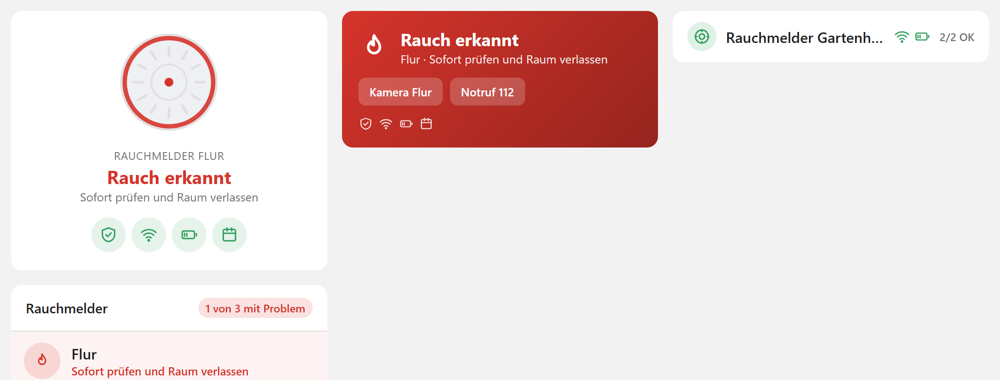
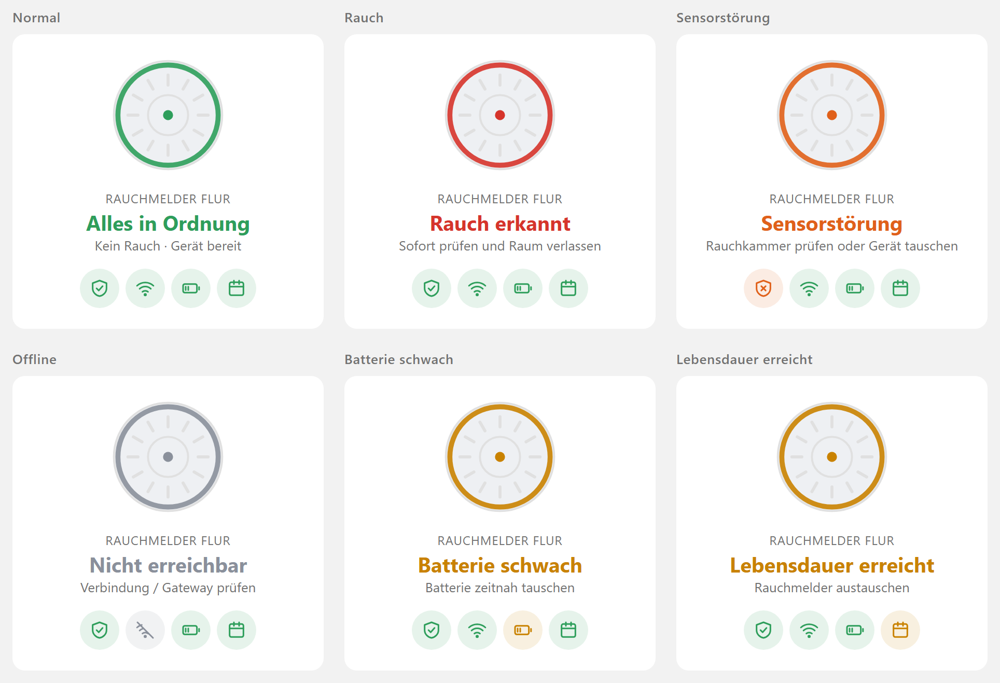
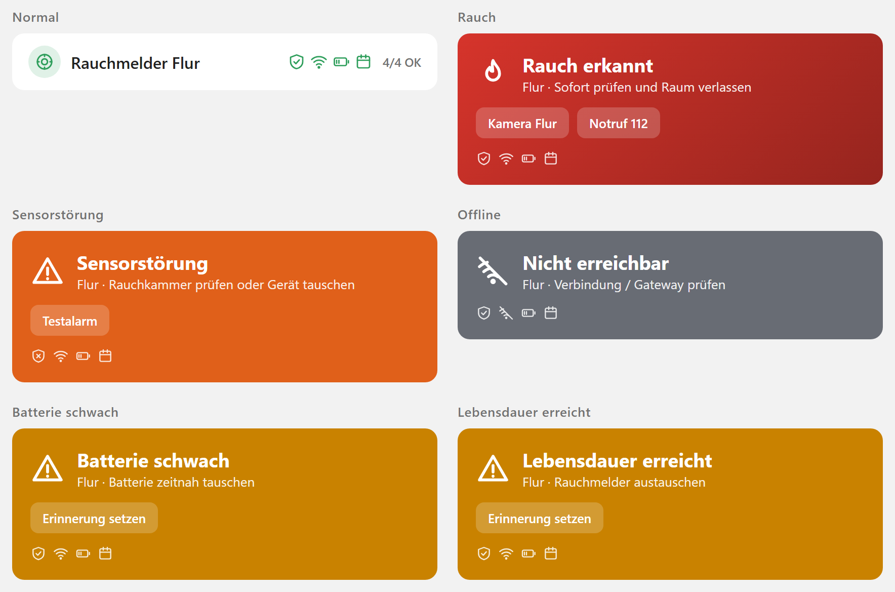
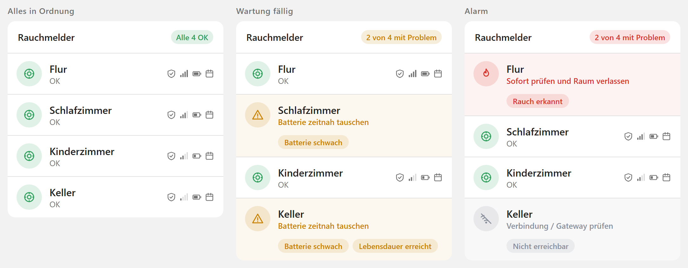

# Smoke Watch Card für Home Assistant

[English](README.md) · **Deutsch** · [Änderungsprotokoll](CHANGELOG.de.md)

Eine Dashboard-Karte, die deine Rauchmelder auf einen Blick zeigt: Rauch, Sensorstörung, Verbindung, Batterie und Lebensdauer. Ist alles in Ordnung, bleibt sie ruhig. Ist etwas nicht in Ordnung, sagt sie, was los ist und was zu tun ist.



## Stile

| Stil | Zeigt | Gut für |
|---|---|---|
| `device` | Einen Melder als Gerät. Ring und LED haben die Farbe des Zustands und blinken bei Rauch. Darunter je ein Symbol für Sensor, Verbindung, Batterie und Lebensdauer. | Eine Raumansicht |
| `alert` | Einen Melder als schmale Zeile, solange alles gut ist, sonst einen farbigen Alarmblock mit eigenen Knöpfen. | Übersichtsseiten |
| `rooms` | Alle Melder in einer Liste. Räume mit Problem sind hervorgehoben und nennen, was nicht stimmt. | Das Haupt-Dashboard |

Zustände nach Wichtigkeit: **Rauch** › **Sensorstörung** › **Offline** › **Batterie schwach** › **Lebensdauer erreicht**.

### Alle Zustände je Stil

**Gerät** (`device`): Ring, LED und Statustext nehmen die Farbe des wichtigsten Problems an. Die Symbole darunter zeigen, welcher Prüfpunkt es ist.



**Alarm zuerst** (`alert`): eine schmale Zeile, solange alles gut ist, sonst ein farbiger Block. Die Knöpfe legst du selbst fest; mit `severity` erscheint jeder nur in den Zuständen, zu denen er passt.



**Raumliste** (`rooms`): Die Plakette im Kopf zählt die Melder mit Problem und hat die Farbe des schlimmsten. Räume mit Problem nennen jeden Prüfpunkt, der nicht in Ordnung ist.



## Installation

1. In HACS dieses Repository als benutzerdefiniertes Repository vom Typ **Dashboard** hinzufügen.
2. **Smoke Watch Card** installieren und den Browser neu laden.

## Einrichtung

Füg die Karte über die Kartenauswahl hinzu und wähl deine Rauch-Entitäten, oder per YAML:

```yaml
type: custom:smoke-watch-card
style: rooms
entities:
  - binary_sensor.flur_rauch
  - binary_sensor.schlafzimmer_rauch
```

Du gibst je Melder nur die **Rauch-Entität** an. Batterie, Verbindung, Störung und Lebensdauer sucht die Karte selbst auf demselben Gerät, den Raumnamen nimmt sie aus dem Bereich des Geräts.

Passt das bei deinen Meldern nicht, legst du sie von Hand fest (`null` schaltet einen Prüfpunkt ab):

```yaml
entities:
  - entity: binary_sensor.kueche_rauch
    name: Küche
    battery: sensor.kueche_rauchmelder_batterie
    online: binary_sensor.kueche_rauchmelder_online
    fault: binary_sensor.kueche_rauchmelder_stoerung
    end_of_life: null
```

| Option | Standard | Bedeutung |
|---|---|---|
| `entities` | – | Rauch-Entitäten, als Text oder mit den Optionen oben |
| `style` | `device` bei einem, `rooms` bei mehreren | `device`, `alert` oder `rooms` |
| `title` | Melder- bzw. Raumname | Titel der Karte |
| `battery_threshold` | `20` | Unter diesem Prozentwert gilt die Batterie als schwach (bei Sensoren in %) |
| `actions` | – | Knöpfe im Alarmblock (Stil `alert`) |

### Knöpfe im Alarmblock

Jeder Knopf nutzt eine normale Home-Assistant-Aktion. Mit `severity` erscheint er nur bei bestimmten Zuständen (`crit`, `fault`, `off`, `warn`).

```yaml
type: custom:smoke-watch-card
style: alert
entities: [binary_sensor.flur_rauch]
actions:
  - name: Kamera Flur
    tap_action:
      action: navigate
      navigation_path: /lovelace/kameras
  - name: Stummschalten
    severity: crit
    tap_action:
      action: perform-action
      perform_action: button.press
      target:
        entity_id: button.flur_rauchmelder_stumm
```

### Was als Problem gilt

| Prüfpunkt | Problem, wenn |
|---|---|
| Rauch | die Rauch-Entität `on` ist |
| Sensorstörung | die Störungs-Entität `on` ist |
| Verbindung | die Verbindungs-Entität `off` ist oder die Rauch-Entität nicht verfügbar ist |
| Batterie | ein Binärsensor `on` ist, ein Sensor in % unter `battery_threshold` liegt oder der Zustand `low` ist |
| Lebensdauer | die Lebensdauer-Entität `on` ist |

> Die Karte zeigt, was deine Melder melden. Ihren eigenen Alarm ersetzt sie nicht.

## Entwicklung

`dev/preview.html` zeigt alle drei Stile mit simulierten Zuständen. Den Repository-Ordner ausliefern, zum Beispiel mit `python -m http.server`, und `/dev/preview.html` öffnen.

Die Screenshots der README kommen aus `dev/screenshots.html` und `dev/preview.html`; `python dev/make_screenshots.py` erzeugt sie neu (braucht Chrome oder Edge und Pillow).
