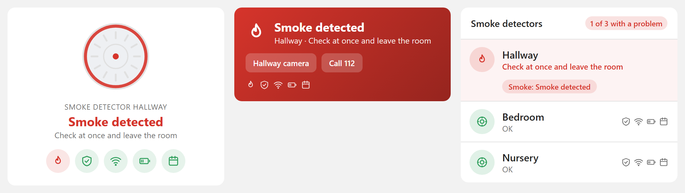

# Smoke Watch Card for Home Assistant

**English** · [Deutsch](README.de.md) · [Changelog](CHANGELOG.md)

A dashboard card that shows your smoke detectors at a glance: smoke, sensor fault, connection, battery and end of life. If everything is fine it stays quiet; if something is wrong it says what and what to do.



## Styles

| Style | Shows | Good for |
|---|---|---|
| `device` | One detector drawn as a device. Ring and LED take the state colour and blink on smoke. Below: one icon per check. | A room view |
| `alert` | One detector as a slim line while all is well; a coloured alert block with your own buttons when not. | Overview pages |
| `rooms` | All detectors in one list. Rooms with a problem are highlighted and list what is wrong. | The main dashboard |

States in order of priority: **smoke** › **sensor fault** › **offline** › **battery low** › **end of life**.

## Installation

1. In HACS, add this repository as a custom repository of type **Dashboard**.
2. Install **Smoke Watch Card** and reload the browser.

## Configuration

Add the card from the card picker and pick your smoke entities, or use YAML:

```yaml
type: custom:smoke-watch-card
style: rooms
entities:
  - binary_sensor.hallway_smoke
  - binary_sensor.bedroom_smoke
```

You only give the **smoke entity** of each detector. The card finds battery, connection, fault and end-of-life entities on the same device by itself and takes the room name from the device's area.

If that does not fit your detectors, set them by hand (`null` switches a check off):

```yaml
entities:
  - entity: binary_sensor.kitchen_smoke
    name: Kitchen
    battery: sensor.kitchen_smoke_battery
    online: binary_sensor.kitchen_smoke_online
    fault: binary_sensor.kitchen_smoke_fault
    end_of_life: null
```

| Option | Default | Meaning |
|---|---|---|
| `entities` | – | Smoke entities, as text or with the options above |
| `style` | `device` for one, `rooms` for several | `device`, `alert` or `rooms` |
| `title` | Detector / room name | Card title |
| `battery_threshold` | `20` | Below this percentage a battery counts as low (for sensors in %) |
| `actions` | – | Buttons in the alert block (style `alert`) |

### Buttons in the alert block

Each button uses a normal Home Assistant action. With `severity` it only appears for certain states (`crit`, `fault`, `off`, `warn`).

```yaml
type: custom:smoke-watch-card
style: alert
entities: [binary_sensor.hallway_smoke]
actions:
  - name: Hallway camera
    tap_action:
      action: navigate
      navigation_path: /lovelace/cameras
  - name: Silence
    severity: crit
    tap_action:
      action: perform-action
      perform_action: button.press
      target:
        entity_id: button.hallway_smoke_silence
```

### What counts as a problem

| Check | Problem when |
|---|---|
| Smoke | the smoke entity is `on` |
| Sensor fault | the fault entity is `on` |
| Connection | the connection entity is `off` or the smoke entity is unavailable |
| Battery | a binary sensor is `on`, a sensor in % is below `battery_threshold`, or the state is `low` |
| End of life | the end-of-life entity is `on` |

> The card shows what your detectors report. It does not replace their own alarm.

## Development

`dev/preview.html` shows all three styles with simulated states. Serve the repository folder, for example with `python -m http.server`, and open `/dev/preview.html`.
